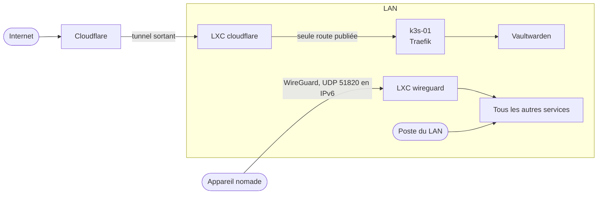

# Homelab

Ce dépôt contient la conception, la réalisation et l'exploitation d'un homelab personnel : un serveur, ses services, et la documentation pour le comprendre et le reconstruire.

L'objectif n'est pas seulement d'avoir un serveur qui fonctionne. Il s'agit de comprendre chaque couche, de justifier chaque choix, et de produire une documentation utilisable dans un contexte professionnel.

> Comprendre → Faire → Vérifier → Documenter

Ce dépôt existe sous deux formes : un dépôt privé, qui est la source, et cette copie publique allégée. La copie est produite par une projection qui remplace les adresses, les noms DNS, les comptes et les secrets par des exemples (`labo.example`, `<ip-machine>`…). Elle ne s'édite jamais à la main, et ses commits reprennent les dates du dépôt privé.

## Ce que fait le homelab

Un seul serveur physique, `pve`, fait tourner Proxmox VE sur ZFS. Il héberge :

- un gestionnaire de mots de passe (Vaultwarden), le seul service publié sur Internet ;
- une forge Git (Gitea) avec son runner de CI, isolé du reste ;
- des médiathèques (Jellyfin, Navidrome) ;
- un partage de fichiers (Samba) ;
- une chaîne de sauvegarde : archives quotidiennes, snapshots ZFS, copie chiffrée sur disque USB (Restic), alerte en cas d'échec.

Les services d'infrastructure légers vivent chacun dans un conteneur LXC, décrit en Ansible. Les applications tournent sur un cluster K3s à un nœud, déployé en GitOps par Argo CD.

Aucun port n'est redirigé vers le LAN en IPv4. En IPv6, la box n'ouvre qu'un port : UDP 51820, vers la passerelle WireGuard. Le tunnel Cloudflare est ouvert par le serveur lui-même, vers l'extérieur. Le reste se joint depuis le LAN, ou par WireGuard.

## En bref

| Couche | Choix |
| --- | --- |
| Matériel | Un serveur : Ryzen 7 5700G, 32 Go de RAM, NVMe de 2 To, deux IronWolf Pro de 8 To en miroir, onduleur |
| Hyperviseur | Proxmox VE sur ZFS (`rpool` sur le NVMe, `tank` en miroir) |
| Services d'infrastructure | Un service par conteneur LXC, décrits en Ansible |
| Applications | K3s à un nœud, Traefik, Argo CD (GitOps), Sealed Secrets |
| Forge et CI | Gitea et son runner isolé ; GitHub Actions valide les manifestes avec `kubeconform` |
| Accès | Tunnel Cloudflare pour le seul service public, WireGuard pour le reste, noms et HTTPS sur le LAN |
| Sauvegardes | Archives quotidiennes, snapshots ZFS, Restic sur disque USB, alerte ntfy, restaurations jouées sur des copies isolées |

## Les choix et leurs raisons

Chaque choix a une décision écrite (ADR), avec ses alternatives et ses conséquences. Les raisons en une ligne :

| Choix | Raison principale | Décision |
| --- | --- | --- |
| Proxmox VE | Isolation, snapshots, administration web, forte adoption en entreprise | [ADR-001](docs/decisions/ADR-001-Proxmox.md) |
| ZFS, miroir pour les données | Des checksums qui détectent les corruptions, et l'autoréparation sur un miroir | [ADR-002](docs/decisions/ADR-002-ZFS.md) |
| Cloudflare Tunnel, puis WireGuard | Une connexion sortante, sans redirection de port. WireGuard prend l'administration depuis le 10 nov. 2026 | [ADR-003](docs/decisions/ADR-003-Cloudflare-Tunnel.md) |
| K3s, un seul nœud | Apprendre Kubernetes sans que le cluster devienne le projet | [ADR-004](docs/decisions/ADR-004-K3s.md) |
| Sealed Secrets | Le secret chiffré est versionné, et déchiffré dans le cluster seulement | [ADR-005](docs/decisions/ADR-005-Sealed-Secrets.md) |
| Argo CD | Savoir si le cluster est conforme à Git, pas seulement l'y appliquer | [ADR-006](docs/decisions/ADR-006-Argo-CD.md) |
| Données de Vaultwarden sur un zvol de `tank` | Reconstruire Proxmox ou la VM sans perdre le coffre | [ADR-008](docs/decisions/ADR-008-Vaultwarden-tank.md) |
| Alerte ntfy | Une panne de sauvegarde arrive sur le téléphone, sans ouvrir de session | [ADR-009](docs/decisions/ADR-009-Alerte-ntfy.md) |
| Ansible pour les LXC | Un conteneur se recrée par une commande, et une deuxième passe ne change rien | [ADR-010](docs/decisions/ADR-010-Ansible-LXC.md) |
| Gitea | Une CI de syntaxe compatible avec GitHub Actions, sous licence MIT | [ADR-011](docs/decisions/ADR-011-Gitea.md) |
| LXC ou K3s, selon les données | Un service qui lit un dataset partagé va en LXC ; un service qui a ses propres données va dans K3s | [ADR-012](docs/decisions/ADR-012-LXC-ou-K3s.md) |
| Noms et HTTPS sur le LAN | Un nom stable et un certificat valide par service, obtenu par défi DNS-01 | [ADR-014](docs/decisions/ADR-014-Noms-HTTPS-LAN.md) |

## Limites assumées

Le homelab a des limites connues. Elles sont écrites, pas cachées :

- **Un seul serveur, un seul nœud K3s.** Ce n'est pas une architecture haute disponibilité. Perdre le nœud, c'est perdre le cluster. La résilience repose sur les sauvegardes et la restauration, pas sur la réplication ([ADR-004](docs/decisions/ADR-004-K3s.md)).
- **Un seul NVMe pour le système.** `rpool` n'a pas de redondance. Seules les données sont en miroir, et un miroir n'est pas une sauvegarde.
- **Aucune copie hors du domicile pour l'instant.** Toutes les copies sont au même endroit que le serveur.
- **Les restaurations sont jouées sur des copies isolées.** Une reprise sur le volume de production n'a pas encore été jouée.
- **La copie sur disque USB se lance à la main.** L'alerte prévient si la dernière copie est trop ancienne.
- **Pas de supervision par métriques.** Il y a une alerte d'échec, mais pas de tableau de bord.
- **La plupart des conteneurs en service ont été créés à la main.** Le moule Ansible a été validé sur des conteneurs d'essai, et les deux derniers conteneurs ont été créés par playbook.

## Ce qui reste à faire

La [feuille de route](docs/FeuilleDeRoute.md) donne l'ordre, les jalons et le critère de fin de chaque phase. Les phases 0 à 9 sont jouées au 16 nov. 2026. La suite :

| Phase | Sujet |
| --- | --- |
| 10 | Ce dépôt public, remis à jour à chaque phase |
| 11 | OpenTofu crée les machines et les réglages Cloudflare, Ansible garde la configuration |
| 12 | Les reprises se jouent, pas seulement s'écrivent |
| 13 | Une copie hors du domicile |
| 14 | Exploitation courante et sécurité |
| 15 | Observabilité |
| 16 | La production est recréée depuis le code |
| 17 | Une application maison, livrée de bout en bout |
| 18 | Un site CV public |

Le suivi des compétences, avec ses niveaux, est dans [competences.md](docs/projet/competences.md).

## Organisation du dépôt

| Chemin | Contenu |
| --- | --- |
| [`docs/`](docs/README.md) | La documentation : architecture, exploitation, décisions (ADR), concepts, journal |
| [`kubernetes/`](kubernetes/) | Les manifestes déployés par Argo CD : Vaultwarden, Gitea, Argo CD lui-même |
| [`infrastructure/`](infrastructure/) | Les scripts et units systemd de `pve` et `k3s-01`, la configuration Samba, et les playbooks Ansible des LXC |
| [`.github/workflows/`](.github/workflows/) | La validation des manifestes à chaque push |

Les fichiers de `infrastructure/` ne se déploient pas d'eux-mêmes : un fichier dans Git n'est pas un fichier installé. Chaque page d'exploitation indique où le copier. La chaîne de sauvegarde, par exemple, est décrite dans [sauvegardes.md](docs/exploitation/sauvegardes.md).

## Par où commencer

1. [docs/README.md](docs/README.md) : le plan de la documentation.
2. [architecture.md](docs/vue-ensemble/architecture.md) : l'état actuel et les principes.
3. [Les décisions (ADR)](docs/decisions/README.md) : pourquoi chaque choix a été fait.
4. [Le journal](docs/projet/journal/README.md) : l'historique des séances.

## Dépôt

La branche principale est `master`.
