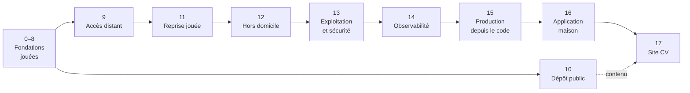

# Feuille de route

Cette page décrit la **cible** et l'**ordre de travail**. Elle ne décrit pas ce qui est en place : c'est le rôle de [architecture.md](vue-ensemble/architecture.md). Le récit détaillé de chaque séance est dans le [journal](projet/journal/README.md).

Chaque phase a un objectif, ses dépendances, des jalons et un critère de fin. Un jalon est coché ✅ seulement quand il a réellement été joué et vérifié.

## Principes

- **Avancer par étapes réversibles.** On construit sur une base fiable, sans multiplier les services avant de maîtriser le stockage, les sauvegardes et le déploiement.
- **Respecter l'existant.** Proxmox, ZFS, K3s, Argo CD et Vaultwarden restent. On ne repart pas de zéro, et on ne migre pas un composant qui fonctionne juste pour uniformiser les outils.
- **Étudier en parallèle, exposer dans l'ordre.** On peut étudier un sujet en avance. En revanche, un service qui **expose** quelque chose ou **stocke** des données importantes attend que ses dépendances soient solides.
- **Ce sont des idées d'ordre, pas un règlement.**

## Vue d'ensemble

| Phase | Sujet | État |
| --- | --- | --- |
| 0 | Fiabiliser l'existant | ✅ Jouée. Deux reprises sur la production restent à jouer, reprises en phase 11 |
| 1 | Organiser les données personnelles | ✅ Jouée (24 oct.) |
| 2 | Sauvegarde Android | ✅ Close (25 oct.) |
| 3 | Forge Git et CI/CD | ✅ Jouée (4 nov.) |
| 4 | Médiathèques | ✅ Jouée (2 nov.) |
| 5 | Une panne de sauvegarde se voit | ✅ Jouée (5 nov.) |
| 6 | Forge et GitOps tenables | ✅ Jouée (6 nov.) |
| 7 | Un LXC se reconstruit | ✅ Jouée (7 nov.) |
| 8 | Le même moule, un LXC à la fois | ✅ Jouée (8 nov.) |
| 9 | Accès distant | 🟡 En cours |
| 10 | Dépôt public allégé | ⬜ À faire, **à commencer tout de suite**, puis mis à jour à chaque phase |
| 11 | La reprise se joue, pas seulement s'écrit | ⬜ À faire |
| 12 | Une copie hors du domicile | ⬜ À faire |
| 13 | Exploitation courante et sécurité | ⬜ À faire |
| 14 | Observabilité | ⬜ À faire |
| 15 | La production sort du code | ⬜ À faire |
| 16 | Une application maison, livrée de bout en bout | ⬜ À faire |
| 17 | Site CV public | ⬜ À faire |

### La logique de l'ordre

Les phases 0 à 8 ont posé les fondations. Les phases restantes suivent une progression simple : **protéger, puis exploiter, puis industrialiser, puis livrer et montrer.**

| Étape | Phases | Pourquoi à ce moment-là |
| --- | --- | --- |
| Finir l'existant | 9 | Clore la phase en cours avant d'en ouvrir d'autres |
| Montrer tôt | 10 | Le dépôt public est ce qu'un recruteur verra en premier. Une première version maintenant, mise à jour à chaque phase, vaut mieux qu'une version parfaite dans trois mois. Elle avance **en parallèle** de tout le reste |
| Protéger | 11, 12 | Avant d'ajouter quoi que ce soit, prouver qu'on sait tout récupérer (11), y compris après un sinistre au domicile (12). La reprise jouée dit aussi quoi copier hors du domicile |
| Exploiter | 13, 14 | Une fois les données à l'abri : mises à jour, redémarrages, durcissement (13), puis la supervision (14), qui surveille un système déjà stabilisé et durci |
| Industrialiser | 15 | La production sort du code. Elle s'appuie sur la reprise (11) pour revenir en arrière, et sur la supervision (14) pour voir qu'une bascule s'est bien passée |
| Livrer | 16 | Une application exposée sur Internet arrive en dernier, sur une base protégée, durcie, supervisée et reproductible |
| Montrer | 17 | Le site CV est la première application livrée par le pipeline de la phase 16, et il raconte le homelab à partir du dépôt public de la phase 10 |

---

## Phase 0 — Fiabiliser l'existant

**Objectif** : récupérer les données et les services après une erreur, une panne de disque ou une mauvaise manipulation.

**Dépendances** : aucune. C'est le prérequis des données personnelles et des nouveaux services.

| Chantier | Actions | Critère |
| --- | --- | --- |
| Snapshots ZFS | Les automatiser, avec une rétention définie | Ils se créent seuls ; une restauration est testée |
| Sauvegarde USB | Une copie externe, déconnectée hors des sauvegardes | Une restauration depuis l'USB réussit |
| Vaultwarden | Une restauration complète : données, configuration, secrets | Le service se récupère sans l'ancienne instance |
| État du stockage | Pool, erreurs, espace, disques | Les contrôles sont écrits, les anomalies visibles |
| Documentation | Sauvegarde, restauration, dépannage | Les opérations essentielles se font à partir de la doc |

Un snapshot ZFS **n'est pas** une sauvegarde : il faut une copie distincte, idéalement hors ligne. Voir [sauvegardes.md](exploitation/sauvegardes.md).

### Jalons

La phase a été jugée assez solide pour démarrer la phase 1. Le rollback par snapshot et la reprise sur le zvol de production sont écrits, mais volontairement **pas joués** : ils passent en phase 11.

- ✅ Snapshots horaires du zvol Vaultwarden : script et timers, rétention de 24. Premiers passages automatiques à 12:00 et 13:00 le 21 oct.
- ✅ Snapshots quotidiens, rétention de 7. Le 6 nov. à 04:00, `@auto-daily-2026-11-06` a été créé, `@auto-daily-2026-10-26` détruit, 7 conservés. Le passage du 22 oct. n'a pas été relu, et il est déjà sorti de la fenêtre. Celui du 21 oct. était manuel.
- ✅ Rétention horaire de 24 vérifiée le 6 nov. à 15:00 : 24 snapshots `auto-hourly`, du 5 nov. 15:00 au 6 nov. 15:00, avec un trou de 4 h. À 13:00, 14:00 et 15:00, le journal détruit l'heure en trop et affiche `24 conservé(s), plafond 24`. Plus aucun horaire d'octobre.
- ⬜ Restauration par rollback d'un snapshot, sur la production. **Reprise en phase 11.**
- ✅ Sauvegarde USB avec Restic : `backup-usb` (20 oct.), restauration d'une archive testée.
- ✅ Rétention des snapshots Restic : 14 jours, appliquée le 5 nov. (passage `<snapshot>`).
- ✅ Restauration isolée de Vaultwarden : technique le 20 oct., connexion le 21 oct. Voir [vaultwarden.md](exploitation/vaultwarden.md).
- ⬜ Reprise réelle sur le zvol de production : [écrite](exploitation/restauration.md), jamais exécutée. **Reprise en phase 11.**
- ✅ Clé Sealed Secrets copiée sous `/tank/backups`, donc dans le périmètre USB.
- ✅ État du stockage documenté : voir [stockage-zfs.md](exploitation/stockage-zfs.md).
- ✅ Opérations déjà faites documentées : sauvegarde, restauration isolée, USB.

---

## Phase 1 — Organiser les données personnelles

**Objectif** : savoir où vivent les données, qui y accède et comment elles sont protégées, **avant** d'installer un portail de fichiers.

**Dépendance** : phase 0 suffisamment validée.

Le travail a porté sur les catégories de données, la distinction entre synchroniser, archiver et sauvegarder, les datasets et les droits, la sauvegarde par catégorie, et le besoin de type « NAS ».

| Solution | Rôle | Limite |
| --- | --- | --- |
| Partages réseau | Accès direct aux fichiers | Peu de synchronisation mobile intégrée |
| Nextcloud | Portail, partage ; contacts et calendrier selon les applications | Plus à maintenir et à sauvegarder |
| Syncthing | Synchronisation de dossiers entre appareils | Ni sauvegarde, ni portail documentaire |
| ZFS seul | Protection locale et organisation | Pas une expérience complète |

**Décision** : ni Nextcloud ni Syncthing. L'accès depuis Windows passe par **SMB**, sur le LAN, dans le LXC `samba` (CT 102, `\\<ip-samba>`, utilisateur `utilisateur`). Voir (document privé) et [samba.md](exploitation/samba.md).

**Critère** : organisation documentée, droits testés, une première restauration de fichiers réussie.

### Jalons

- ✅ Inventaire des données : voir (document privé).
- ✅ Datasets et copies depuis le PC (23 oct., originaux conservés) : `documents`, `images`, `musique`, `projets`, `videos`.
- ✅ Décisions : pas de Nextcloud ni de Syncthing ; SMB dans un LXC ; pas de doublon sous `/tank/backups`.
- ✅ `backup-usb` élargi aux dossiers personnels : passage du 24 oct., snapshot `<snapshot>`.
- ✅ Partage SMB sur le LAN : CT 102, cinq partages. Samba retiré de `pve`. Voir [samba.md](exploitation/samba.md).
- ✅ Droits : lecture et écriture depuis Windows (24 oct.).
- ✅ Première restauration d'un fichier personnel : depuis `<snapshot>` vers `/tmp`, SHA-256 identique (24 oct.).

---

## Phase 2 — Sauvegarde Android

**Objectif** : une procédure reproductible pour changer de téléphone, ou récupérer après une perte.

**Dépendances** : phase 0 pour la protection, phase 1 pour le stockage cible.

Aucune solution ne copie tout un téléphone Android. On sépare donc par type de données, et on **écrit les exceptions** plutôt que de promettre une image complète.

| Données | Approche | Limite |
| --- | --- | --- |
| Photos et vidéos | Copie vers le serveur, puis sauvegarde indépendante | Vérifier les originaux |
| Documents et téléchargements | Copie ou transfert planifié | Certains dossiers sont exclus selon l'application |
| Contacts et calendrier | Export ou synchronisation compatible | Restauration et doublons |
| SMS et appels | Outil dédié, export récupérable | Système, droits, version d'Android |
| WhatsApp | Sauvegarde officielle, ou transfert | Copier les fichiers ne restaure pas les conversations |
| Signal | Sauvegarde ou transfert de l'application | Données chiffrées, clé de restauration |
| Données d'applications | Inventaire et exports disponibles | Android bloque souvent les données privées |
| APK | Inventaire | Un APK n'embarque pas les données |
| Réglages | Procédure écrite | Dépend du fabricant |

**Critère** : une matrice par type de données (méthode, fréquence, lieu, limites, dernier test de restauration). Elle est dans (document privé).

### Jalons

Phase **close le 25 oct.** Périmètre retenu : photos, contacts, SMS si possible. Calendrier et secrets hors périmètre. La procédure vise LineageOS et GrapheneOS.

- ✅ Inventaire : LineageOS 22.2, Android 15, aucune sauvegarde du constructeur.
- ✅ Applications : Obtainium quand l'éditeur publie une source ; Aurora Store pour le Play Store (avec microG sous LineageOS, avec les services Play et un compte Google à part sous GrapheneOS). Liste installée le 25 oct. ; une application depuis le Play Store. Export Obtainium sur `tank`, dans le snapshot `<snapshot>`.
- ✅ Photos : pellicule copiée dans `/tank/images/telephone` (24 oct., par le PC), SHA-256 vérifié sur une photo. Snapshots `<snapshot>` et `<snapshot>`. Restauration du dossier non exigée.
- ✅ Contacts : `contacts_20261024_151331.vcf`, 52 fiches. Restauration depuis `<snapshot>`, SHA-256 identique. Importé sur le nouveau téléphone le 24 oct.
- ✅ SMS : export Fossify Messages, un message reconnu sur `pve`. Pas restauré, faute de besoin. Dans `<snapshot>`.
- ✅ Signal : sauvegarde du 24 oct. 20:47, restaurée sur le nouveau téléphone le même jour. Clé hors du dossier. Dans `<snapshot>`.
- ✅ WhatsApp : transfert d'un téléphone à l'autre (24 oct.). Aucun fichier sur `tank`.

---

## Phase 3 — Forge Git et CI/CD

**Objectif** : Gitea en édition libre, et un flux de travail professionnel : un push lance les contrôles, puis un déploiement repris par Argo CD, avec un retour arrière.

**Dépendance** : phase 0. La forge doit être sauvegardée **avant** d'y mettre des éléments essentiels.

K3s et Argo CD restent en place pour ce qui y tourne déjà. Le mode d'hébergement des nouveaux services suit l'[ADR-012](decisions/ADR-012-LXC-ou-K3s.md).

### Comparaison de Gitea et Forgejo

Décision du 3 nov. : **Gitea, édition libre**. Les six critères ont été examinés le même jour : maintenance et gouvernance, fonctions Git, CI/CD, déploiement, écosystème, coût dans ce homelab. Voir l'[ADR-011](decisions/ADR-011-Gitea.md) et [forge-gitea.md](exploitation/forge-gitea.md).

**Critère** : un changement versionné passe les contrôles et se déploie, avec un retour arrière.

### Jalons

- ✅ Gitea, édition libre (3 nov.). Enterprise non retenu.
- ✅ Ressources de `k3s-01` relevées (3 nov.) : 7,5 Gio de RAM dont 5,5 Gio disponibles, 4 cœurs, 3,3 Gio d'échange inutilisé, 51 Go libres sur le disque système. Vaultwarden utilise 14 Mio, Argo CD jusqu'à 206 Mio.
- ✅ Pod Gitea sur `k3s-01` (3 nov.) : une réplique, SQLite, zvol dédié `tank/vmdata/vm-101-gitea-data`.
- ✅ Sauvegarde du dossier de données, Gitea arrêté (3 nov.) : `gitea-2026-11-03_180902.tar`, SHA-256 `<empreinte-vérifiée>`, relue ailleurs. Ce n'est pas l'archive de référence.
- ✅ Dépôt d'essai, branche `master` protégée : le push direct est refusé, la demande de fusion n° 1 est fusionnée (`ad9faf2`).
- ✅ Miroir d'essai vers GitHub (4 nov.) : `admin/essai-miroir` vers `TLGitDev/essai-miroir`, même commit `e2e0eb6a` des deux côtés. Le jeton reste dans le coffre.
- ✅ Runner hors de `k3s-01` (4 nov.) : CT 107, `<ip-runner>`, sans montage de `tank` ni droit sur le cluster. `gitea-runner` v5.2.0, étiquette `host`.
- ✅ Premier workflow vert (4 nov.) : CI n° 1, commit `0813dcc290`, en 2 s.
- ✅ Déploiement repris par Argo CD depuis GitHub, puis retour arrière (4 nov.) : application `essai-deploiement`, commits `a6c4965` puis `31fcdee`, rollback Argo vers `a6c4965`. Application retirée le 6 nov. (`60a930e`).
- ✅ Accès depuis l'extérieur (4 nov.), derrière Access. Route désactivée depuis le 10 nov. : voir la phase 9.
- ✅ Restauration de la forge et du runner, jouée une fois (4 nov.) : archive `gitea-2026-11-04_150155.tar`, SHA-256 `<empreinte-vérifiée>`. C'est l'archive de référence.

---

## Phase 4 — Médiathèques

**Objectif** : une bibliothèque de films, de séries et de musique organisée, accessible et maintenable.

**Dépendances** : phases 0 et 1. Les volumes et les droits passent **avant** les applications.

Les médias récupérables n'ont pas besoin de la même sauvegarde que les documents irremplaçables. Leurs **configurations** et leurs métadonnées, si.

**Critère** : un fichier de test suit le parcours prévu, et les configurations se restaurent. Voir [médiathèques](exploitation/mediatheques/README.md).

### Jalons

- ✅ Dataset `tank/mediatheques`, groupe `media` (GID 987), dossiers en `2770` (27 oct.).
- ✅ Copie depuis le PC : 2,1 Tio (28 oct.), originaux conservés.
- ✅ Jellyfin, CT 103 (`<ip-jellyfin>`), 12.4+deb13 : scan terminé, un film lu (28 oct.). Voir [jellyfin.md](exploitation/mediatheques/jellyfin.md).
- ✅ qBittorrent, CT 104 (`<ip-qbittorrent>`) : fichier de test en `0660`, groupe `media` (28 oct.).
- ✅ Prowlarr 2.7.0.5723, Sonarr 4.0.20.3014, Radarr 6.4.4.10685 sur le CT 105 (28 oct.). Une série reconnue dans Sonarr, un film téléchargé par Radarr. Voir [servarr.md](exploitation/mediatheques/servarr.md).
- ✅ Bazarr v1.6.2, profil `français`, aucun fournisseur (29 oct.).
- ✅ Indexeur Knaben validé (29 oct.). EZTV retiré : `eztvx.to` ne se résout pas.
- ✅ Proton VPN sur le CT 104 (29 oct.), avec redirection de port et coupure vérifiée (`000`). La configuration Mullvad est conservée. Voir [qbittorrent-vpn.md](exploitation/mediatheques/qbittorrent-vpn.md).
- ✅ Recyclarr v8.8.1 (1er nov.) : profils MULTi.VO créés, non assignés.
- ✅ Lidarr 3.1.6.5079 (1er nov.) : `sons/` importé, sans recherche.
- ✅ Navidrome 0.64.2, CT 106 (2 nov.), lecture validée avec Symfonium 15.1.0. Voir [navidrome.md](exploitation/mediatheques/navidrome.md).
- ✅ Interfaces publiées derrière Access (2 nov.), puis retirées d'Internet le 10 nov. : voir la phase 9.
- ✅ Configurations sauvegardées dans `/tank/backups/mediatheques`, restauration relue, snapshot USB `<snapshot>` (2 nov.).

---

## Phase 5 — Une panne de sauvegarde se voit

**Objectif** : savoir, sans ouvrir de session, qu'une sauvegarde n'a pas tourné, qu'un pool n'est plus sain ou qu'un disque se remplit.

**Dépendance** : les sauvegardes de la phase 0. Pas une pile de tableaux de bord : un seul canal.

Décision du 5 nov. : **ntfy**, instance publique, sujet hors du dépôt. Le courriel est écarté (secret SMTP, message qui peut rester bloqué), Healthchecks aussi (il lui faut encore un canal). Limite connue : si `pve` est arrêté, le contrôle quotidien ne part pas. Voir l'[ADR-009](decisions/ADR-009-Alerte-ntfy.md) et [sauvegardes.md](exploitation/sauvegardes.md).

Le canal couvre cinq cas :

- l'échec du timer d'archive Vaultwarden ;
- l'échec du timer de snapshots du zvol ;
- une copie USB plus vieille que 14 jours ;
- `tank` dans un autre état que `ONLINE`, ou un scrub en erreur ;
- moins de 10 % d'espace libre sur `tank` ou `rpool`.

**Critère** : un échec volontaire a prévenu, sans qu'il ait fallu aller voir le timer.

### Jalons

- ✅ Canal choisi et noté (5 nov.) : ntfy.
- ✅ Rétention Restic appliquée (5 nov., passage `<snapshot>`) : 6 snapshots gardés, 7 retirés.
- ✅ Les cinq contrôles branchés sur le canal (5 nov.).
- ✅ Scrub mensuel de `tank` planifié, premier passage le 6 déc. à 05:00.
- ✅ Échec volontaire, message reçu, job d'essai retiré (5 nov. 10:14). Depuis, une vraie alerte est arrivée lors d'une sauvegarde en échec.

---

## Phase 6 — Forge et GitOps tenables

**Objectif** : la forge se restaure depuis une copie qui n'est pas sur son nœud, et un manifeste cassé se voit avant Argo CD.

**Dépendance** : phase 5 jouée.

Décisions du 4 nov. : Argo CD continue de lire GitHub, et `homelab` n'a pas de copie de travail sur Gitea. Le contrôle des manifestes tourne sur GitHub et ne déploie rien.

**Critère** : la forge se restaure depuis une copie hors de `k3s-01` ; le dépôt lu par Argo CD refuse un manifeste cassé ; il ne reste aucune application d'essai `OutOfSync`.

### Jalons

- ✅ Archive de référence recopiée sur `pve` (6 nov.) : `/tank/backups/k3s-01/gitea/gitea-2026-11-04_150155.tar`, empreinte identique, snapshot USB `<snapshot>`.
- ✅ Contrôle GitHub des manifestes (6 nov.) : `kubeconform` v0.8.0, schéma Kubernetes 1.36.4, mode strict. Première exécution verte (`0a70da8`). Voir [argocd.md](concepts/argocd.md).
- ✅ Un manifeste volontairement invalide rend le contrôle rouge (`66f4880`), puis il est retiré (`193e6cd`, vert).
- ✅ `ROOT_URL` de Gitea passé à `https://gitea.labo.example/` (`e2a1837`). À revoir depuis que la route est coupée : voir la phase 9.
- ✅ `essai-deploiement` retiré du cluster et du dépôt (`60a930e`). `root` est `Synced` et `Healthy`.

---

## Phase 7 — Un LXC se reconstruit

**Objectif** : à partir du modèle Debian déjà présent sur `pve`, une commande recrée le runner. Une deuxième passe ne change rien.

**Dépendance** : phase 6 jouée.

Décision du 4 nov. : **Ansible**, lancé depuis le PC, et pas depuis le runner, qui n'a pas à pouvoir recréer l'hyperviseur. Le jeton d'API Proxmox et le jeton d'enregistrement Gitea restent hors du dépôt. Voir l'[ADR-010](decisions/ADR-010-Ansible-LXC.md) et [ansible.md](exploitation/ansible.md).

**Critère** : le runner d'essai existe parce que le playbook l'a créé, et relancer le playbook est sans effet.

### Jalons

- ✅ Rôles et playbook dans `infrastructure/ansible/` (7 nov., `c1a1e07`). Le playbook vise le CT 108 et refuse le 107.
- ✅ ADR-010 accepté (7 nov.) : les LXC d'infrastructure se décrivent en Ansible, les applications restent dans Argo CD, Proxmox reste un mode opératoire.
- ✅ CT 108 créé par le playbook, runner enregistré, CI d'essai verte en 2 s (Essai n° 3, `4ce9657`). Binaire v5.2.0 vérifié par son empreinte (`2eb05e7c09701ba194c6a43b8669db7eadf0d5c69b6f59f5710426fd68f82f98`).
- ✅ Deuxième passe sans changement (`changed=0`).
- ✅ CT 108 retiré, le 107 reste en service (`c8cee20`). Relancer le playbook recréerait le 108.

---

## Phase 8 — Le même moule, un LXC à la fois

**Objectif** : chaque LXC posé à la main suit le moule de la phase 7, un seul à la fois.

**Dépendance** : phase 7 jouée.

Même critère à chaque fois : conteneur d'essai d'abord, commande unique, deuxième passe sans changement, secrets hors de Git. Le conteneur en service ne bouge pas. Le détail des essais est dans [ansible.md](exploitation/ansible.md).

**Critère** : chaque LXC a son playbook, validé sur un conteneur d'essai.

### Jalons

Tous joués le 8 nov., du plus simple au plus risqué. Chaque conteneur d'essai a été détruit après l'essai ; relancer le playbook le recréerait.

- ✅ Navidrome : CT 109 `navidrome-essai`, réponse HTTP locale.
- ✅ Jellyfin : CT 110 `jellyfin-essai`, `/health` à `Healthy`. L'essai a `jellyfin-ffmpeg8`, le 103 en service a encore `jellyfin-ffmpeg7`.
- ✅ Samba : CT 111 `samba-essai`, `smbd` actif, écriture refusée (montages en lecture seule).
- ✅ servarr : CT 112 `servarr-essai`, pages locales, écriture refusée.
- ✅ qBittorrent : CT 113 `qbittorrent-essai`, sortie du compte coupée (`000`), sans la clé Proton.
- ✅ Cloudflare : CT 114 `cloudflare-essai`, `cloudflared` 2026.10.7 arrêté, sans le jeton. Le 100 en service a encore 2026.10.4.

> **Limite** : les conteneurs **en service** restent ceux créés à la main. Les playbooks sont prouvés, mais la production n'en sort pas encore, et des écarts existent déjà (versions de `jellyfin-ffmpeg` et de `cloudflared`). C'est l'objet de la phase 15.

---

## Phase 9 — Accès distant

**Objectif** : l'administration reste privée, joignable depuis le téléphone sans exposer d'interface sur Internet.

**Dépendance** : phase 7 jouée.

**Critère** : aucune interface d'administration n'est joignable depuis Internet ; chaque service s'ouvre par le LAN ou par WireGuard, sous un nom stable.

### Jalons

- ✅ Passerelle WireGuard (9 nov.) : CT 115 `wireguard`, `<ip-wireguard>/24`, créé par `playbooks/wireguard.yml`. Réseau `<réseau-wg>`, seul le téléphone (`<ip-wg-téléphone>/32`) a une clé. UDP 51820 en IPv6, la box étant en CGNAT. Deuxième passe sans changement. Détail : [ansible.md](exploitation/ansible.md) et le [journal](projet/journal/2026-11.md).
- ✅ Chaque service ouvert depuis le téléphone, Wi-Fi coupé (10 nov.) : Proxmox, Gitea, Jellyfin, Navidrome, qBittorrent, Prowlarr, Sonarr, Radarr, Lidarr, Bazarr, Argo CD (`http://<ip-k3s-01>/`). Page d'accueil `https://<ip-wireguard>/` servie par le 115.
- ✅ Services publics et interfaces d'administration séparés (10 nov.) : seul Vaultwarden reste publié sur Cloudflare. Voir [cloudflare.md](exploitation/cloudflare.md).
- ⬜ Vérifier le `ROOT_URL` de Gitea. Il vaut `https://gitea.labo.example/` depuis le 6 nov., mais la route est coupée depuis le 10 nov. : les URL de clonage et les liens des courriels pointent peut-être vers une adresse injoignable. Choisir l'adresse LAN (`http://<ip-k3s-01>:3000/`), joignable aussi par WireGuard, puis vérifier un clone depuis le PC et depuis le téléphone.
- ⬜ Ouvrir le partage SMB (`\\<ip-samba>`, CT 102) à travers WireGuard. Aujourd'hui, le téléphone n'y accède pas hors du Wi-Fi. Deux points : ajouter TCP 445 vers `<ip-samba>` aux services autorisés par le filtre du 115, et vérifier l'adresse source vue par Samba. `smb.conf` n'accepte que `<réseau-lan>` : si le 115 ne masque pas les clients derrière sa propre adresse, il faut aussi accepter `<réseau-wg>`. Vérifier ensuite depuis Material Files, Wi-Fi coupé. Voir [samba.md](exploitation/samba.md).
- ✅ `/admin` de Vaultwarden fermé depuis Internet (11 nov.) : route Traefik `vaultwarden-admin-public` et middleware `refuser-tout`, commit `cfebb18`. Vérifié : sur le nom public, `/admin` et `/admin/` répondent `403`, `/` répond `200` ; sur le LAN, `https://<ip-k3s-01>/admin` répond `200`. En 4G, le téléphone affiche « Forbidden » sur `/admin` et le coffre s'ouvre. Voir [vaultwarden.md](exploitation/vaultwarden.md), section 3.
- ⬜ Relire la configuration exposée de Vaultwarden : inscriptions fermées, invitations, réglages enregistrés depuis `/admin` (fichier `/data/config.json`, prioritaire sur les variables d'environnement).
- ⬜ **Des noms et du HTTPS sur le LAN.** Aujourd'hui, les services se joignent par `IP:port`, en HTTP pour la plupart. Viser un nom par service (par exemple `jellyfin.lan.<domaine>`), résolu par un DNS interne, et un certificat valide obtenu par défi DNS-01 auprès de Cloudflare, sans rien publier. Le reverse proxy existant (Traefik) ou un petit LXC dédié porte les certificats. Vérifier : chaque service s'ouvre par son nom, en HTTPS, sans alerte de certificat, depuis le LAN et par WireGuard. Ce jalon simplifie aussi le `ROOT_URL` de Gitea.

---

## Phase 10 — Dépôt public allégé

**Objectif** : une copie publique de ce dépôt, sur GitHub, qui montre le travail (décisions, manifestes, scripts, journal) sans donner la carte du réseau ni un secret.

**Dépendance** : phase 7 jouée. Il n'est pas nécessaire d'attendre les autres phases : la copie se remet à jour à chaque phase. **C'est la phase à commencer en premier**, puisqu'elle est ce qu'un recruteur verra.

Décision du 4 nov. : ce dépôt reste privé et reste la seule source. La copie publique ne s'édite jamais à la main. Une **projection**, rejouée depuis le PC, produit l'arbre public, puis le pousse.

La projection garde le plus possible. Elle remplace plutôt qu'elle ne supprime des pages entières :

| Ce qui sort | Ce qui reste, réécrit |
| --- | --- |
| Jetons, mots de passe, clés, SealedSecrets | Le manifeste, sans l'objet secret |
| Adresses LAN, plan d'adressage, origines et UUID du tunnel | Le nom du rôle (`pve`, `k3s-01`, `samba`…) |
| Noms DNS du labo | Un nom d'exemple : associer le vrai nom à l'architecture donnerait la carte |
| Chemins d'archives, empreintes de sauvegarde, comptes | Le fait qu'une archive a été relue et qu'une empreinte a été vérifiée |
| Le dossier `docs/prive/` | Rien : il ne sort pas |
| Adresses de courriel personnelles (politique Access) | Une adresse d'exemple |

**Critère** : un lecteur du dépôt public suit les ADR, les manifestes et le journal, sans en tirer une adresse privée, un secret, ni le nom DNS qui joint le service.

### Jalons

- ⬜ La règle ci-dessus écrite à côté du script, avec un exemple avant et après.
- ⬜ Une projection rejouable. Une deuxième passe ne change la copie publique que si le labo a changé.
- ⬜ Un contrôle automatique sur l'arbre produit, en plus de la relecture : recherche d'adresses `192.168.`, `10.`, d'empreintes, de noms DNS du labo, de mots-clés de secret, et un outil de détection de secrets (par exemple Gitleaks). Le push est refusé si le contrôle trouve quelque chose.
- ⬜ Relecture humaine de l'arbre produit.
- ⬜ `competences.md` relu : une ligne n'est publique que si un jalon a été joué.
- ⬜ Un `README` public pensé pour un lecteur pressé : ce que fait le homelab, un schéma, les choix et leurs raisons, ce qui reste à faire. Il assume les limites (un seul nœud, un seul NVMe).
- ⬜ Le dépôt GitHub public, créé et alimenté par la projection.

---

## Phase 11 — La reprise se joue, pas seulement s'écrit

**Objectif** : chaque scénario de [restauration.md](exploitation/restauration.md) est **joué** au moins une fois, ou explicitement accepté comme non joué, avec la raison. Le temps de reprise est mesuré.

**Dépendances** : phases 0 et 6, phase 9 jouée. À jouer avant d'ajouter de nouvelles données importantes.

Aujourd'hui, le tableau de restauration compte plusieurs « jamais joué » : la restauration du coffre sur la production, la reconstruction de `k3s-01`, la perte de `tank`, le remplacement d'un disque, et la perte du NVMe, qui n'est même pas écrite en détail. En entretien, c'est la première question qui suit « j'ai des sauvegardes ».

Règle de prudence : on joue d'abord **à côté** de la production (clone d'un snapshot, VM d'essai), et sur la production seulement dans une fenêtre annoncée, après une sauvegarde fraîche.

**Critère** : chaque ligne du tableau de restauration porte une date de test, ou une décision écrite de ne pas la jouer. Le RTO (temps de reprise) et le RPO (perte de données acceptable) sont notés pour chaque service.

### Jalons

- ⬜ **RTO et RPO écrits** pour chaque service (Vaultwarden, Gitea, médiathèques, données personnelles), et confrontés à la fréquence réelle des sauvegardes. Le disque USB manuel donne aujourd'hui un RPO de 14 jours pour les données personnelles hors `tank`.
- ⬜ **Rollback d'un snapshot du zvol Vaultwarden.** D'abord sur un clone (`zfs clone`) monté à côté, puis sur la production dans une fenêtre annoncée. Reprend le jalon ouvert de la phase 0.
- ⬜ **Restauration d'une archive sur le volume Vaultwarden en service** (scénario 3.1). Reprend le jalon ouvert de la phase 0.
- ⬜ **Reconstruire `k3s-01` à côté de la production** (scénario 3.2) : une VM d'essai, K3s, la clé Sealed Secrets restaurée, Argo CD amorcé depuis Git, et des **clones** des zvols Vaultwarden et Gitea. Vérifier que les deux services démarrent avec leurs données. Mesurer le temps. Aucun risque pour la production.
- ⬜ **Écrire en détail la perte du NVMe** (scénario 7), puis vérifier que tout ce qu'il faut est sauvegardé : `/etc/pve`, la configuration réseau, `/etc/subuid` et `/etc/subgid`, les scripts et timers installés, les clés SSH de service. Si une pièce manque, l'ajouter à `/tank/backups`, donc au périmètre USB.
- ⬜ **Remplacement d'un disque de `tank`** (scénario 6) : écrire la procédure, avec l'identification du disque par son numéro de série, et décider s'il faut la répéter (`zpool offline` puis `online`, resilver observé) ou seulement l'écrire.
- ⬜ **Perte de `tank`** (scénario 3.3) : restaurer depuis l'USB un échantillon représentatif (un dossier personnel, une archive Vaultwarden, la clé Sealed Secrets) vers un emplacement d'essai, et le vérifier.
- ⬜ **Un exercice complet chronométré**, une fois par an : un scénario tiré au hasard, joué uniquement à partir de la documentation. Ce qui manque à la doc est corrigé.

---

## Phase 12 — Une copie hors du domicile

**Objectif** : la règle **3-2-1** est respectée pour les données irremplaçables : trois copies, sur deux supports, dont une hors du domicile. Un incendie, un vol ou un dégât des eaux ne fait perdre ni le coffre, ni les documents, ni les photos.

**Dépendance** : phase 11 commencée, pour savoir ce qu'on protège et en combien de temps on le récupère.

Aujourd'hui, toutes les copies sont dans la même pièce : `tank`, ses snapshots et le disque USB. Le tableau de [sauvegardes.md](exploitation/sauvegardes.md) marque la « copie chiffrée hors site » comme **prévue**.

Deux familles de solutions, à trancher dans un ADR :

| Solution | Avantage | Limite |
| --- | --- | --- |
| Un second disque USB, gardé chez un proche, échangé régulièrement | Aucun abonnement, données hors ligne | Dépend d'un geste humain ; RPO de plusieurs semaines |
| Un stockage objet ou un espace distant, alimenté par Restic | Automatisable, vérifiable, alertable | Coût mensuel, secret d'accès à protéger, débit montant de la box |

**Critère** : une restauration depuis la copie hors domicile a été jouée, sur une machine qui n'est pas `pve`, en ne s'aidant que de la documentation et du mot de passe Restic.

### Jalons

- ⬜ Volume à protéger mesuré : coffre, `/tank/backups`, dossiers personnels. Les médiathèques restent exclues.
- ⬜ ADR : destination hors domicile, coût, chiffrement (Restic chiffre déjà côté client), rétention.
- ⬜ Copie en place. Si elle est automatique : un timer, et son échec passe par ntfy.
- ⬜ Contrôle d'ancienneté de la copie hors domicile ajouté à `check-sauvegardes.sh`.
- ⬜ Vérification d'intégrité périodique (`restic check`, avec lecture d'un échantillon de données).
- ⬜ **Le mot de passe Restic et la procédure existent hors du homelab.** Si `pve` et Vaultwarden disparaissent ensemble, il faut encore pouvoir déchiffrer : une copie papier ou un second gestionnaire, rangé ailleurs.
- ⬜ Restauration jouée depuis la copie hors domicile, sur une autre machine.

---

## Phase 13 — Exploitation courante et sécurité

**Objectif** : le homelab se met à jour, redémarre et se défend sans improvisation. Les routines sont écrites et ont été jouées.

**Dépendances** : phase 9 jouée, phases 11 et 12 jouées (les données sont à l'abri avant de toucher aux mises à jour).

**Critère** : chaque composant a une politique de mise à jour écrite et appliquée ; un redémarrage complet de `pve` ne demande aucune intervention ; un audit des accès a été fait et ses écarts corrigés.

### Jalons

**Mises à jour**

- ⬜ Une politique écrite par couche : Proxmox, Debian dans les LXC, K3s, images des conteneurs, Gitea, applications des médiathèques. Pour chacune : fréquence, source des annonces de sécurité, procédure, retour arrière.
- ⬜ Mises à jour de sécurité automatiques dans les LXC Debian (`unattended-upgrades`), décidées conteneur par conteneur.
- ⬜ Les versions des images dans `kubernetes/` suivies automatiquement : un outil comme Renovate ouvre une demande de fusion à chaque nouvelle version, et le contrôle `kubeconform` la valide.
- ⬜ Une montée de version de K3s jouée selon la procédure écrite, avec un snapshot de la VM avant.

**Redémarrages**

- ⬜ Ordre et délais de démarrage relus pour chaque VM et LXC (le 100 démarre avec `order=1,up=30`).
- ⬜ **Redémarrage à froid de `pve` joué** : tout revient sans intervention. Les services sont vérifiés un par un, et le temps de retour est noté.
- ⬜ **Onduleur** : vérifier si `pve` est prévenu d'une coupure secteur. Sinon, brancher le câble de données et configurer NUT, pour un arrêt propre avant la fin de la batterie et une alerte ntfy. Tester avec une coupure simulée.

**Sécurité**

- ⬜ Inventaire des comptes et des accès : qui se connecte où, avec quoi. Pas de `root@pam` au quotidien dans l'interface Proxmox, mais un compte nominatif.
- ⬜ Double authentification sur l'interface Proxmox et sur Gitea.
- ⬜ SSH par clé uniquement, sur `pve` et `k3s-01`, mots de passe désactivés.
- ⬜ Revue du pare-feu : refus par défaut sur chaque conteneur, seuls les ports utiles ouverts. Vérification par un balayage (`nmap`) depuis le LAN et depuis WireGuard, comparé à la liste attendue.
- ⬜ Inventaire des secrets, avec leur lieu de stockage et leur procédure de rotation : jeton du tunnel, clé Sealed Secrets, `ADMIN_TOKEN`, jetons Ansible et Gitea, clés WireGuard, clé Proton. Une rotation jouée au moins une fois.
- ⬜ Surveillance SMART des trois disques (`smartd`), avec une alerte ntfy sur un attribut qui se dégrade.

---

## Phase 14 — Observabilité

**Objectif** : voir l'état du homelab d'un coup d'œil, et être prévenu quand un **service** tombe, pas seulement une sauvegarde.

**Dépendance** : phase 13 commencée. ntfy reste le canal d'alerte.

Aujourd'hui, la supervision se limite aux cinq contrôles de la phase 5. Rien ne prévient si Jellyfin, Gitea ou le tunnel ne répondent plus, et aucune métrique n'est conservée.

À trancher dans un ADR : une pile Prometheus et Grafana (standard en entreprise, plus lourde), ou plus léger (Uptime Kuma pour la disponibilité, Netdata pour les métriques). Selon l'[ADR-012](decisions/ADR-012-LXC-ou-K3s.md), une pile dont les données tiennent dans un volume dédié va dans K3s.

**Critère** : un service arrêté volontairement déclenche une alerte en quelques minutes ; un tableau de bord montre CPU, mémoire, disques, pools ZFS et état des services.

### Jalons

- ⬜ ADR : outil de métriques, outil de disponibilité, durée de conservation, emplacement.
- ⬜ Sonde de disponibilité pour chaque service, interne et externe (Vaultwarden vu depuis Internet).
- ⬜ Métriques de `pve` (hôte, ZFS, VM et LXC) et de `k3s-01` (nœud, pods).
- ⬜ Un tableau de bord principal, versionné dans le dépôt.
- ⬜ Alertes vers ntfy : service injoignable, disque qui se remplit, certificat qui expire, pod qui redémarre en boucle.
- ⬜ Journaux centralisés (par exemple Loki), au moins pour `pve`, `k3s-01` et le tunnel. Optionnel, à décider dans l'ADR.
- ⬜ Essai : arrêter volontairement un service, recevoir l'alerte, le redémarrer, voir l'alerte se résoudre.

---

## Phase 15 — La production sort du code

**Objectif** : chaque conteneur **en service** a été recréé par son playbook. Ce qui tourne est ce qui est décrit dans Git, et un écart se détecte.

**Dépendances** : phase 8 jouée, phase 11 jouée (savoir revenir en arrière), phase 14 en place (voir qu'une bascule s'est bien passée).

Les phases 7 et 8 ont prouvé les playbooks sur des conteneurs d'essai. Mais les conteneurs en service ont été créés à la main, et ils dérivent déjà : `jellyfin-ffmpeg7` sur le 103 au lieu de 8, `cloudflared` 2026.10.4 sur le 100 au lieu de 2026.10.7. De même, les scripts de `pve` sont dans Git, mais leur installation reste manuelle. Tant que la production n'est pas sortie du code, « l'infrastructure est en code » n'est vrai qu'à moitié.

**Critère** : un passage en mode vérification (`ansible-playbook --check --diff`) sur toute la production ne montre aucun écart.

### Jalons

- ⬜ Chaque playbook peut viser le conteneur en service, en mode vérification, sans rien modifier. Les écarts sont relevés.
- ⬜ Bascule de chaque conteneur en service vers sa version créée par le playbook, un à la fois, du moins risqué au plus risqué (même ordre qu'en phase 8, runner en premier). Pour chacun : sauvegarde de la configuration, bascule, vérification, retour arrière prêt.
- ⬜ Les scripts et timers de `pve` installés par un playbook, au lieu de copies à la main. Révision de l'ADR-010 sur ce point.
- ⬜ La VM `k3s-01` décrite en code : création (cloud-init ou playbook) et installation de K3s. Ce jalon rend aussi le scénario 3.2 de la phase 11 plus rapide.
- ⬜ Contrôles automatiques sur GitHub pour le code d'infrastructure : `ansible-lint`, `yamllint`, `shellcheck`, en plus de `kubeconform`.
- ⬜ Un passage de vérification planifié (par exemple chaque semaine), qui signale un écart par ntfy.

---

## Phase 16 — Une application maison, livrée de bout en bout

**Objectif** : une application développée ici passe d'un commit à la production par un pipeline complet (tests, image, analyse, déploiement GitOps, retour arrière) et elle est exposée sur Internet **sans** mettre en danger le reste du homelab.

**Dépendances** : phases 13, 14 et 15. L'**ADR-013** est écrit et appliqué **avant** toute exposition.

Un conteneur seul n'isole pas assez une application publique : une faille dans l'application, ou dans le noyau partagé, peut donner accès au nœud, donc à Vaultwarden et à Gitea. L'ADR-013 doit trancher les protections. Voir l'[ADR-012](decisions/ADR-012-LXC-ou-K3s.md).

Le site CV (phase 17) est le candidat recommandé pour cette première application : peu de données, peu de risque, et il montre le pipeline à ceux qui le lisent.

**Critère** : un commit sur l'application arrive en production sans geste manuel autre que la validation de la demande de fusion ; l'image déployée a été analysée ; un retour arrière se fait en une opération ; l'application ne peut joindre ni Vaultwarden, ni Gitea, ni l'API Kubernetes.

### Jalons

- ⬜ **ADR-013 écrit** : nœud ou VM séparés pour les applications publiques, `NetworkPolicy` qui refuse tout par défaut, Pod Security au niveau `restricted`, pas de jeton de compte de service monté, conteneurs non root avec système de fichiers en lecture seule, limites de ressources.
- ⬜ Isolation appliquée et **vérifiée** : depuis un pod de l'application, Vaultwarden, Gitea, l'API Kubernetes et le LAN sont injoignables.
- ⬜ Pipeline sur le runner Gitea : tests, construction de l'image, analyse de vulnérabilités (par exemple Trivy) qui bloque sur une faille critique, publication dans le registre de Gitea.
- ⬜ Déploiement GitOps : le pipeline propose la nouvelle version de l'image dans les manifestes, Argo CD la déploie après fusion.
- ⬜ Retour arrière joué : revenir à la version précédente, mesurer le temps.
- ⬜ Exposition par le tunnel Cloudflare, avec limitation de débit et règles de pare-feu applicatif.
- ⬜ Supervision de l'application (phase 14) et sauvegarde de ses données, si elle en a.

---

## Phase 17 — Site CV public

**Objectif** : un site qui présente le profil, les projets et le homelab. Le homelab y est raconté à partir du dépôt public, jamais à partir du labo.

**Dépendances** : phase 10 pour le contenu. Phase 16 pour le pipeline, si le site est la première application maison, ce qui est recommandé.

- Dépôt versionné, contenus publics seulement.
- Génération et validation automatiques, puis déploiement. Exposition minimale, HTTPS.
- Trois récits, chacun avec sa limite :
  1. **Une donnée survit à la machine.** Miroir, copie externe, restauration jouée. Limite : le système est sur un seul NVMe, et certaines reprises restent écrites, pas jouées (voir la phase 11).
  2. **Un changement a un chemin et un retour arrière.** Branche protégée, secret chiffré, runner hors du nœud du coffre, Argo CD. Limite : seuls les manifestes se reconstruisent par GitOps ; les LXC suivent leur playbook, mais la production n'en sort pas encore (voir la phase 15).
  3. **L'accès distant est refusé par défaut.** Pas de redirection de port, tunnel sortant, WireGuard pour l'administration. Limite : le coffre s'authentifie dans l'application.
- Une correspondance homelab → cloud : hyperviseur, isolation, stockage et instantanés, accès sans port ouvert, GitOps, secrets versionnés, copie externe.
- Un lien vers le dépôt public. Aucun lien vers une interface d'administration, ni vers le dépôt privé.

**Critère** : le site raconte le homelab, un commit le redéploie, et aucune donnée du labo privé n'y figure.

### Jalons

- ⬜ Les trois récits, leurs limites et la correspondance cloud sont sur le site.
- ⬜ Le site pointe vers le dépôt public de la phase 10, et seulement vers lui.
- ⬜ Première version en ligne, en HTTPS.
- ⬜ Un commit validé déclenche le déploiement.
- ⬜ Relecture : rien n'a été copié à la main depuis le labo.

---

## Décisions encore ouvertes

| Sujet | Où en est la décision | Quand |
| --- | --- | --- |
| Adresse de référence de Gitea | `ROOT_URL` pointe vers une route coupée. Adresse LAN, ou nom interne en HTTPS | Phase 9 |
| Noms et certificats internes | DNS interne et certificats DNS-01 : outil et emplacement à choisir | Phase 9 |
| Copie hors du domicile | Second disque échangé, ou stockage distant alimenté par Restic | Phase 12, dans un ADR |
| Outils de supervision | Prometheus et Grafana, ou plus léger | Phase 14, dans un ADR |
| Portée d'Ansible | Les scripts de `pve` et la VM `k3s-01` entrent-ils dans Ansible ? Révision de l'ADR-010 | Phase 15 |
| Applications maison exposées | K3s visé, mais un conteneur n'isole pas assez à lui seul. À trancher dans l'ADR-013 | Avant la **première** application publique, phase 16 |
| Hébergement du site CV | Dans le homelab (phase 16), ou chez un hébergeur de sites statiques | Phase 17 |

Pas d'ADR tant que le choix n'est pas tranché.

### Décisions déjà tranchées

| Sujet | Décision | ADR ou page |
| --- | --- | --- |
| Forge Git | Gitea, édition libre (3 nov.). Argo CD lit GitHub (4 nov.). Contrôle des manifestes sur GitHub | [ADR-011](decisions/ADR-011-Gitea.md), [forge-gitea.md](exploitation/forge-gitea.md) |
| Stockage personnel | SMB sur le LAN ; ni Nextcloud, ni Syncthing | (document privé) |
| Sauvegarde Android | Outils par type de données | (document privé) |
| Hébergement d'un service | Un service qui lit ou écrit un dataset de fichiers sur `tank` va en LXC ; un service aux données propres va dans K3s, sur un zvol dédié (11 nov.) | [ADR-012](decisions/ADR-012-LXC-ou-K3s.md) |
| Musique | Navidrome, client Symfonium (2 nov.) | [navidrome.md](exploitation/mediatheques/navidrome.md) |
| Accès distant | Seul Vaultwarden reste publié ; WireGuard pour tout le reste (9 et 10 nov.) | [ADR-003](decisions/ADR-003-Cloudflare-Tunnel.md), [cloudflare.md](exploitation/cloudflare.md) |
| Alerte | ntfy, cinq contrôles, rétention et seuil USB à 14 jours, espace à 10 % (5 nov.) | [ADR-009](decisions/ADR-009-Alerte-ntfy.md) |
| Reconstruction des LXC | Ansible depuis le PC (4 nov.), six playbooks validés (7 et 8 nov.) | [ADR-010](decisions/ADR-010-Ansible-LXC.md), [ansible.md](exploitation/ansible.md) |
| Dépôt montré | Le labo reste privé et seule source ; une projection alimente un dépôt public (4 nov.) | Phase 10 |

---

## Hors phases

Idées **gardées**, mais pas planifiées :

- Home Assistant.
- Paperless.
- Immich.
- Un second NVMe en miroir pour `rpool`, pour que la perte d'un disque système ne coupe plus tout. C'est la principale limite matérielle du homelab.
- **Page agent** sur le téléphone, une fois la forge prête (idée du 3 nov.). Un pod sur `k3s-01` avec le programme `agent`, et une page maison : la conversation, et des diffs plus lisibles qu'en terminal. Le téléphone ouvre cette page. Le pod ne voit que son volume : ni le disque de la machine, ni le cluster. La clé du compte Cursor reste dans le pod, et le modèle tourne chez Cursor. Le nom n'est pas choisi. Comme toute application exposée, elle attendrait l'ADR-013. Absente du récit d'entretien tant que le pod n'existe pas.

L'onduleur n'est plus un chantier matériel : il est en place et protège le serveur (voir [materiel.md](vue-ensemble/materiel.md)). Son intégration logicielle est un jalon de la phase 13.

---

## Idées de fonctionnement

Ce ne sont pas des règles strictes.

1. Un déploiement important à la fois, tant que le précédent n'est pas solide. L'étude en parallèle est bienvenue.
2. Sauvegarder avant une migration ou un changement de structure, et prévoir un retour arrière.
3. Une sauvegarde jamais restaurée reste une inconnue.
4. Documenter **après** validation : choix, chemins, incidents.
5. Ne pas migrer un composant qui fonctionne juste pour « tout mettre pareil ».
6. Ne pas exposer les données personnelles ni les interfaces d'administration « pour que ce soit plus simple ».
7. Avant un nouveau service, vérifier la RAM, le CPU, le disque, les sauvegardes, et le temps disponible pour le maintenir.
8. Un LXC devient reproductible sur le moule déjà prouvé, un à la fois.
9. Jouer à côté de la production avant de jouer sur la production.
