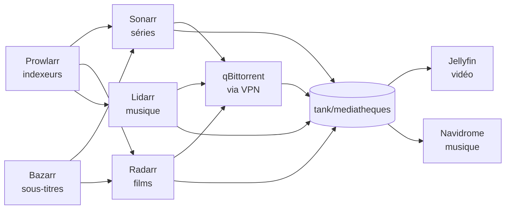

# Médiathèques

Les médiathèques regroupent films, séries et musique sur un dataset dédié, `tank/mediatheques` (2,1 Tio), et les applications qui s'en servent. Chacune vit dans son propre LXC et accède aux fichiers par un groupe commun, `media`. Tout se joint depuis le LAN ou par WireGuard ; aucune n'est publiée sur Internet.

C'est la phase 4 de la [feuille de route](../../FeuilleDeRoute.md). Voir aussi [stockage-zfs.md](../stockage-zfs.md), [sauvegardes.md](../sauvegardes.md) et, pour les données personnelles qui suivent une autre politique, (document privé).

## 1. Vue d'ensemble



| Application | Rôle | Conteneur | Adresse | Document |
| --- | --- | --- | --- | --- |
| Jellyfin | Lecture des films et séries | CT 103 | `<ip-jellyfin>:8096` | [jellyfin.md](jellyfin.md) |
| qBittorrent | Téléchargement, par Proton VPN | CT 104 | `<ip-qbittorrent>:8080` | [qbittorrent-vpn.md](qbittorrent-vpn.md) |
| Prowlarr, Sonarr, Radarr, Bazarr, Recyclarr, Lidarr | Gestion des bibliothèques | CT 105 | `<ip-servarr>` | [servarr.md](servarr.md) |
| Navidrome | Lecture de la musique | CT 106 | `<ip-navidrome>:4533` | [navidrome.md](navidrome.md) |

## 2. Organisation du stockage

### Un seul dataset

Films, séries, musique et téléchargements partagent **un seul dataset** : `tank/mediatheques`. Deux raisons :

- **Une même politique.** Ces fichiers sont récupérables : ils ne sont **pas** dans `backup-usb`, n'ont pas de snapshots et pas de quota. C'est une politique différente de celle de `tank/musique` ou de `tank/videos`, qui sont des données personnelles et restent à part.
- **Les liens physiques.** Sonarr et Radarr créent un lien physique (*hardlink*) entre le fichier téléchargé et la bibliothèque, sans le copier. Un lien physique ne peut pas traverser deux datasets. Si les téléchargements étaient dans un autre dataset, chaque fichier serait copié, et occuperait deux fois la place.

```
tank/mediatheques
├── films
├── series
├── sons
└── telechargements
    ├── incomplets
    └── complets
```

| Dossier du PC | Dossier sur `tank` |
| --- | --- |
| `Mediatheques/Films` | `/tank/mediatheques/films` |
| `Mediatheques/Séries` | `/tank/mediatheques/series` |
| `Mediatheques/Sons` | `/tank/mediatheques/sons` |

### Droits

| Élément | Valeur |
| --- | --- |
| Groupe | `media`, GID **987** sur l'hôte |
| Dossiers | `2770`, `root:media` : le groupe lit et écrit, les autres n'ont aucun accès ; le bit *setgid* fait hériter le groupe aux nouveaux fichiers |
| Fichiers | `0660` |
| Membres | Les comptes de service des applications, chacun dans son conteneur. `utilisateur` n'est **pas** dans ce groupe |

### Réglages ZFS

| Propriété | Valeur | Raison |
| --- | --- | --- |
| `compression` | `on` | Posée explicitement (source `local`), même si le pool l'avait déjà |
| `recordsize` | 128K (défaut) | On ne le change pas sans un besoin mesuré |
| Snapshots | Aucun | Données récupérables |
| Quota | Aucun | La taille n'était pas connue avant la copie |
| `backup-usb` | Absent | Seules les **configurations** des applications sont sauvegardées (voir [sauvegardes.md](../sauvegardes.md), procédure 8.6) |

### Pas de partage SMB pour l'instant

Le LXC `samba` (CT 102) ne mappe que les utilisateurs `utilisateur` (999) et `perso` (988). Ajouter `media` obligerait à réécrire cette correspondance d'identifiants et à redémarrer Samba, qui sert déjà les cinq partages personnels. La copie initiale s'est donc faite en root, par SFTP.

## 3. Procédures

### 3.1 Créer le dataset

Procédure jouée le 27 oct. 2026 à 10:14. Elle reste ici pour une reconstruction. Faire les blocs **dans l'ordre**. Ne jamais improviser de `zfs destroy` ni de `rm` sur `/tank`.

**Prérequis**

- Un shell `root` sur `pve`.
- Le constat confirme que ni `tank/mediatheques`, ni le groupe `media` n'existent :

```bash
zfs list -r -o name,used,avail,mountpoint tank
zfs get compression,mountpoint tank tank/documents
getent group media || true
getent group perso
id utilisateur
ls -ld /tank/mediatheques 2>/dev/null || true
```

Si le groupe `media` existe déjà, s'arrêter et relever la sortie de `getent`.

**Action**

```bash
zfs create tank/mediatheques
zfs set compression=on tank/mediatheques
getent group media >/dev/null || groupadd --system media
chgrp media /tank/mediatheques
chmod 2770 /tank/mediatheques
install -d -m 2770 -o root -g media \
  /tank/mediatheques/films \
  /tank/mediatheques/series \
  /tank/mediatheques/sons \
  /tank/mediatheques/telechargements/incomplets \
  /tank/mediatheques/telechargements/complets
chmod 2770 /tank/mediatheques/telechargements
```

Le dernier `chmod` est indispensable. `install -d` n'applique le mode qu'au **dernier** dossier de chaque chemin. Le dossier intermédiaire `telechargements/` sort donc en `2755` (`drwxr-sr-x`), sans droit d'écriture pour le groupe.

**Vérification**

```bash
zfs list -o name,used,avail,mountpoint tank/mediatheques
zfs get compression,mountpoint,recordsize tank/mediatheques
getent group media
ls -ld /tank/mediatheques \
  /tank/mediatheques/films \
  /tank/mediatheques/series \
  /tank/mediatheques/sons \
  /tank/mediatheques/telechargements \
  /tank/mediatheques/telechargements/incomplets \
  /tank/mediatheques/telechargements/complets
```

- Compression `on`, point de montage `/tank/mediatheques`, `recordsize` 128K.
- Tous les dossiers en `drwxrws---`, `root:media`.
- `backup-usb` inchangé.

**Retour arrière** : **seulement** si le dataset est vide et qu'aucun conteneur ne le monte. Lancer `zfs destroy tank/mediatheques`, puis `groupdel media` si le groupe ne sert plus. Jamais pendant une copie.

### 3.2 Copier les médias depuis le PC

Procédure jouée le 28 oct. 2026. Les originaux restent sur le PC : c'est une copie, pas un déplacement.

**Prérequis**

- Le dataset existe (procédure 3.1).
- Le client OpenSSH est installé sur Windows. Sinon : Paramètres → Applications → Fonctionnalités facultatives → « Client OpenSSH ».

**Action**

1. Copier le **contenu** de chaque dossier dans son dossier de destination, jamais à la racine du dataset. Rien ne va dans `telechargements/`.

   Avec PowerShell (adapter la lettre `F:` si besoin). Le `*` copie le contenu, et pas le dossier lui-même :

```powershell
scp -r "F:\Mediatheques\Films\*" root@<ip-pve>:/tank/mediatheques/films/
scp -r "F:\Mediatheques\Series\*" root@<ip-pve>:/tank/mediatheques/series/
scp -r "F:\Mediatheques\Sons\*" root@<ip-pve>:/tank/mediatheques/sons/
```

   Avec WinSCP : SFTP, utilisateur `root`, hôte `<ip-pve>`. Glisser le **contenu** de chaque dossier, sinon on obtient `films/Films`.

   Une copie interrompue ne reprend pas où elle s'était arrêtée : relancer la même commande recopie tout par-dessus.

2. Sur `pve`, rétablir les droits. Les fichiers déposés en root n'héritent pas tout seuls du groupe :

```bash
chgrp -R media /tank/mediatheques
find /tank/mediatheques -type d -exec chmod 2770 {} +
find /tank/mediatheques -type f -exec chmod 0660 {} +
du -sh --max-depth=1 /tank/mediatheques
```

**Vérification**

- Les commandes ne renvoient aucune erreur.
- `du` affiche la taille totale, et celle de chaque sous-dossier grâce à `--max-depth=1`. Sans cette option, `du -sh /tank/mediatheques /tank/mediatheques/*` ne réaffiche pas les sous-dossiers, déjà comptés dans le parent.

## 4. Historique

| Date | Événement |
| --- | --- |
| 10 nov. 2026 | Routes publiques des *arr et de Navidrome désactivées. Tout se joint par le LAN ou par WireGuard. |
| 2 nov. 2026 | Configurations des CT 103 à 106 archivées dans `/tank/backups/mediatheques`, restauration relue, snapshot USB `<snapshot>`. Navidrome en service. Les cinq interfaces *arr publiées derrière Access ; page de liens abandonnée. |
| 1er nov. 2026 | Lidarr et Recyclarr installés. |
| 29 oct. 2026 | qBittorrent passe par Proton VPN. Bazarr installé, indexeur Knaben ajouté. |
| 28 oct. 2026 | Copie depuis le PC : 2,1 Tio. Le détail par dossier n'a pas été relevé. Jellyfin, qBittorrent, Prowlarr, Sonarr et Radarr en service. |
| 27 oct. 2026, 10:14 | Dataset créé. Avant : `tank` utilisait 99,7 Gio et avait 7,04 Tio libres, compression déjà `on`, groupe `media` absent, `perso` = 988, `utilisateur` = 999. Après : dataset de 96 Kio, groupe `media:x:987:`. À 10:17, `telechargements/` corrigé de `2755` en `2770`. |

## 5. Suite

- **Partage SMB `Mediatheques`** : seulement si l'Explorateur Windows doit écrire ici. Il faudrait alors étendre la correspondance d'identifiants du CT 102, sans casser `perso`.
- **Mullvad** : la configuration `wg0.conf.mullvad` reste sur le CT 104. La clé Mullvad ne se révoque pas depuis le conteneur.
- **Navidrome** : le client Android Symfonium 15.1.0 est validé ; Tempus n'a pas été testé.
