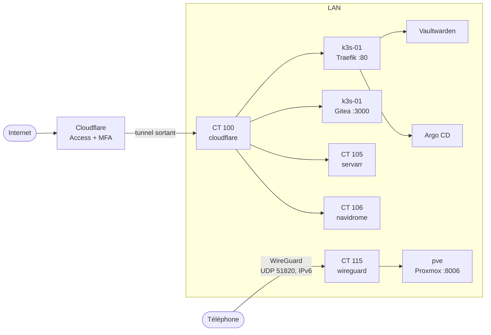

# Architecture du homelab

Le homelab tourne sur un seul serveur physique, `pve`, sous Proxmox VE. Les services d'infrastructure légers vivent chacun dans un conteneur LXC. Les applications tournent sur un cluster K3s à un nœud, piloté en GitOps par Argo CD. Les données dorment sur un miroir ZFS. Depuis Internet, on n'entre que par un tunnel Cloudflare sortant ou par WireGuard.

Ce document décrit les principes et l'état actuel. Il ne décrit ni les manipulations (voir le [journal](../projet/journal/)), ni le matériel ([materiel.md](materiel.md)), ni la cible ([FeuilleDeRoute.md](../FeuilleDeRoute.md)).

## 1. Vue d'ensemble



Le serveur ouvre lui-même une connexion **sortante** vers Cloudflare. Aucun port n'est redirigé vers le LAN en IPv4. La seule ouverture sur la box est une règle IPv6 vers la passerelle WireGuard.

## 2. Principes

### Méthode de travail

L'objectif n'est pas d'obtenir vite un résultat, mais de comprendre chaque technologie. Chaque choix doit pouvoir être justifié, et chaque commande expliquée. Le but final est de devenir autonome pour concevoir, administrer et dépanner une infrastructure.

Une infrastructure fiable n'est pas une infrastructure sans pannes. C'est une infrastructure dont les pannes sont prévisibles, limitées et faciles à réparer.

Le travail suit toujours le même ordre :

> Comprendre → Manipuler → Vérifier → Documenter → Automatiser

Pour chaque nouvelle technologie :

1. Comprendre le problème qu'elle résout.
2. Comprendre son architecture.
3. Identifier ses concepts fondamentaux.
4. Observer son fonctionnement.
5. Passer à la pratique.
6. Documenter ce qui a été appris.

Les commandes viennent en dernier : on cherche à comprendre les mécanismes, pas à mémoriser des procédures.

### Diagnostiquer avant d'agir

On ne corrige jamais un problème au hasard. On suit six étapes :

1. Observer.
2. Émettre une hypothèse.
3. Vérifier cette hypothèse.
4. Identifier la cause racine.
5. Corriger.
6. Vérifier que le problème a disparu.

### Vérifier plutôt que supposer

Une information n'est vraie qu'une fois vérifiée : adresse IP, port, chemin, certificat, DNS, journal, nom de domaine. Une hypothèse se confirme par un test (`curl`, `ping`, `systemctl status`, `zpool status`…), pas par une conviction. Une erreur de configuration est souvent plus probable qu'un bug logiciel. Les sprints 7 et 8 du [journal](../projet/journal/) en donnent des exemples.

### Comprendre avant d'exécuter

Avant de lancer une commande, on sait ce qu'elle doit faire, comment elle le fait, ce qu'elle modifie et comment revenir en arrière.

### Installer n'est pas configurer

Installer un logiciel le rend disponible. Le configurer lui donne son rôle. Par exemple, `apt install cloudflared` installe le binaire ; c'est `cloudflared service install <token>` qui le relie au tunnel.

### Une identité n'est pas un nom

Les outils d'administration s'appuient sur des identifiants stables. Les noms lisibles, eux, peuvent changer.

| Identifiant stable | Nom lisible, qui peut changer |
| --- | --- |
| ID du conteneur (`100`) | Nom d'hôte (`cloudflare`) |
| UUID du tunnel | Nom du tunnel |

### Penser en couches

Chaque couche dépend de celle du dessous. Une panne visible en haut peut venir d'une couche plus basse.

```
Applications
Services
VM / conteneurs
Proxmox
Debian
Linux
Firmware
Matériel
```

### Séparer les responsabilités

Chaque service d'infrastructure léger a son propre LXC. Les applications tournent sur K3s. Ce découpage simplifie la maintenance, limite l'impact d'une panne, isole les mises à jour, et permet de supprimer ou recréer un service sans toucher aux autres.

### Moindre privilège

Chaque service n'a que les droits dont il a réellement besoin. Les LXC sont non privilégiés, et aucun service applicatif n'est installé directement sur Proxmox. L'objectif est de réduire la surface d'attaque.

### Isoler

Les processus, la mémoire, le processeur, le stockage et la configuration de chaque service sont isolés. Une panne ou une faille dans un service ne doit pas toucher le reste.

### Ne jamais dépendre d'un seul composant

- Les données sont sur un miroir de deux disques (`tank`). Le système (`rpool`), lui, reste sur un seul NVMe.
- L'accès distant empile plusieurs couches de sécurité (voir [cloudflare.md](../exploitation/cloudflare.md)).
- Les services sont isolés dans des conteneurs distincts.
- Les sauvegardes sont indépendantes du stockage principal (voir [sauvegardes.md](../exploitation/sauvegardes.md)).

### Ne créer une ressource que pour un besoin réel

Dataset, VM, conteneur, réseau, utilisateur : rien n'est créé « au cas où ». L'architecture suit les besoins au lieu de les anticiper, ce qui limite la complexité. Pour le cas des datasets ZFS, voir [stockage-zfs.md](../exploitation/stockage-zfs.md).

### Utiliser les dépôts officiels

Les logiciels viennent de leur dépôt officiel quand il existe (Debian, Proxmox, Cloudflare). On obtient ainsi les correctifs de sécurité par APT, sans binaire téléchargé à la main. Tout dépôt APT ajouté vient du projet officiel ou d'une organisation de confiance, et il est signé par une clé GPG.

### Protéger les secrets

Les mots de passe, les clés SSH et les jetons ne sont jamais partagés ni versionnés. Un Secret Kubernetes n'est **pas chiffré** par défaut : il est seulement encodé en Base64. Dans Git, les secrets applicatifs sont donc des SealedSecrets (voir l'[ADR-005](../decisions/ADR-005-Sealed-Secrets.md)).

### N'exposer que le nécessaire

Par défaut, un service n'est joignable que depuis le LAN, sans redirection de port. On ne l'expose que lorsqu'un besoin le justifie.

### Défense en profondeur et refus par défaut

Aucune couche ne protège seule l'infrastructure. Pour les services derrière Cloudflare Access, tout accès est refusé tant qu'une règle ne l'autorise pas. Le détail est dans [cloudflare.md](../exploitation/cloudflare.md).

## 3. Réseau

Le serveur est relié en Ethernet à la box. Les serveurs ont une adresse fixe, pour rester joignables par le reverse proxy et les tunnels. Les postes utilisateurs restent en DHCP. Le plan d'adressage est dans [adressage.md](adressage.md).

```
Internet
   │
 Box (<ip-box>)
   │
 eno1  ← carte réseau physique
   │
 vmbr0 ← switch virtuel
 ├── Proxmox (.50)
 ├── cloudflare (.20)
 ├── k3s-01 (.30)
 └── …
```

`vmbr0` est un switch virtuel. Les VM et les LXC y sont branchés, et lui-même est branché sur la carte physique `eno1`.

L'administration se fait depuis le LAN. Aucun port de Proxmox n'est exposé sur Internet, et l'API Kubernetes n'est pas publiée. Voir l'[ADR-003](../decisions/ADR-003-Cloudflare-Tunnel.md).

## 4. Où tourne quoi

| Type | Usage | Exemples |
| --- | --- | --- |
| LXC Debian Stable | Services d'infrastructure légers | `cloudflare`, `wireguard`, `samba`, `runner`, médiathèques |
| K3s (VM `k3s-01`) | Applications | Vaultwarden, Argo CD, Gitea |
| VM | Quand un noyau dédié est nécessaire | `k3s-01` |

Les LXC consomment peu de mémoire, démarrent vite et partagent le noyau de Proxmox tout en restant isolés. Ils suivent deux conventions : un service d'infrastructure par LXC, et un nom d'hôte égal au nom du service. Le choix entre K3s, LXC et VM se fait au cas par cas, selon le besoin.

Les disques **système** des LXC et des VM sont des volumes sous `rpool/data` (par exemple `vm-101-disk-1`, 64 Go, pour `k3s-01`). Les volumes de **données** sont sous `tank/vmdata`. Les ISO et les modèles sont dans `rpool/var-lib-vz`.

Le chemin d'une requête publique vers une application du cluster est le suivant :

```
Internet → Cloudflare → tunnel → LXC cloudflare → Traefik (<ip-k3s-01>:80) → Ingress → Service → Pod
```

Gitea fait exception : le tunnel le joint directement, sans passer par Traefik.

## 5. Exposition des services

| Service | Adresse publique | Cloudflare Access | Origine |
| --- | --- | --- | --- |
| Proxmox | Aucune : route `proxmox.labo.example` désactivée le 10 nov. 2026 | — | LAN, ou WireGuard depuis le téléphone |
| Argo CD | `argocd.labo.example` | Oui | Traefik, `<ip-k3s-01>:80` |
| Gitea | `gitea.labo.example` | Oui | `<ip-k3s-01>:3000`, sans Traefik |
| Prowlarr, Sonarr, Radarr, Lidarr, Bazarr | `<outil>.labo.example` | Oui | CT 105 `servarr` |
| Vaultwarden | `vaultwarden.labo.example` | **Non** | Traefik, `<ip-k3s-01>:80` |
| Vaultwarden (LAN) | Aucune : `https://<ip-k3s-01>` | — | Traefik, port 443 (IngressRoute `vaultwarden-lan`, ajoutée le 10 nov. 2026) |
| Navidrome | `navidrome.labo.example` | **Non** | `<ip-navidrome>:4533` |
| Jellyfin | Aucune | — | LAN seulement (`<ip-jellyfin>:8096`) |
| qBittorrent | Aucune | — | LAN seulement (`<ip-qbittorrent>:8080`) |
| Samba | Aucune | — | LAN seulement, sans accès Internet |

Les outils d'administration publiés sont tous derrière Access, avec MFA. Proxmox n'est plus publié du tout. Vaultwarden et Navidrome n'y sont pas, parce que ces applications authentifient déjà leurs clients elles-mêmes. Le téléphone joint aussi le LAN par WireGuard (CT 115).

## 6. Stockage

Le NVMe (`rpool`) porte l'**infrastructure** : Proxmox et les disques système des VM et des conteneurs. Le miroir `tank` porte les **données** qui doivent survivre à une reconstruction de `rpool`.

Vaultwarden en est l'exemple : ses données sont sur le zvol `tank/vmdata/vm-101-vaultwarden-data`. La chaîne est la suivante : zvol → ext4 → Local PV → PVC `vaultwarden-zfs-pvc`. L'ancien PVC `local-path` est conservé figé. Il n'y a ni NFS pour SQLite, ni pilote CSI ZFS. Voir l'[ADR-008](../decisions/ADR-008-Vaultwarden-tank.md) et [stockage-zfs.md](../exploitation/stockage-zfs.md).

## 7. Plateforme

K3s (`<ip-k3s-01>`) est la plateforme des applications, avec Traefik comme Ingress Controller. Argo CD déploie le contenu du dossier `kubernetes/` du dépôt (voir [argocd.md](../concepts/argocd.md)). Les notions de base sont dans [kubernetes.md](../concepts/kubernetes.md).

Les scripts d'exploitation sont versionnés dans `infrastructure/` (pour `pve` et `k3s-01`). Attention : un fichier dans Git n'est pas un fichier installé dans `/usr/local/sbin`. Les LXC d'infrastructure sont décrits en Ansible dans `infrastructure/ansible/` (voir l'[ADR-010](../decisions/ADR-010-Ansible-LXC.md)).

## 8. État des lieux

| Domaine | Élément | État |
| --- | --- | --- |
| Fondations | Matériel, Proxmox, réseau | En place |
| Fondations | Cloudflare Tunnel, Access, MFA | En place |
| Fondations | ZFS `rpool` et `tank` (miroir 2 × 8 To) | En place |
| Fondations | Onduleur | En place, il protège le serveur |
| Sauvegardes | Archives Vaultwarden quotidiennes et restauration isolée | En place, restauration testée |
| Sauvegardes | Snapshots du zvol Vaultwarden (horaires et quotidiens) | En place |
| Sauvegardes | Disque USB avec Restic (`backup-usb`) | En place, **lancement manuel** |
| Sauvegardes | Reprise réelle du zvol | Procédure écrite, **jamais jouée** |
| Sauvegardes | Rétention Restic | **À faire** |
| Supervision | Alerte ntfy | Installée ; voir l'[ADR-009](../decisions/ADR-009-Alerte-ntfy.md) |
| Supervision | Supervision (métriques, tableaux de bord) | **À faire** |
| Plateforme | K3s + Traefik | En place |
| Plateforme | Argo CD (GitOps) | En place |
| Données | Données personnelles sur `tank`, partage SMB | En place (phase 1) |
| Données | Sauvegarde du téléphone | En place (phase 2, close) |
| Services | Vaultwarden, sur `tank` | En place |
| Services | Gitea et son runner (CT 107) | En place |
| Services | Jellyfin, qBittorrent, Prowlarr, Sonarr, Radarr, Bazarr, Recyclarr, Lidarr, Navidrome | En place |
| Automatisation | LXC d'infrastructure en Ansible | Playbooks validés sur conteneurs d'essai |

### Détail des services

| Service | Où | Version | Remarques |
| --- | --- | --- | --- |
| Vaultwarden | K3s | — | `https://vaultwarden.labo.example`. Données sur `tank` (`vaultwarden-zfs-pvc`). `ADMIN_TOKEN` stocké en hash Argon2 PHC. |
| Jellyfin | CT 103, `<ip-jellyfin>:8096` | — | Lecture seule sur `tank/mediatheques` |
| qBittorrent | CT 104, `<ip-qbittorrent>:8080` | — | Écrit uniquement dans `telechargements/`. Sort par Proton VPN ; la configuration Mullvad est conservée. |
| Prowlarr | CT 105, `:9696` | 2.7.0.5723 | Compte `utilisateur` |
| Sonarr | CT 105, `:8989` | 4.0.20.3014 | |
| Radarr | CT 105, `:7878` | 6.4.4.10685 | |
| Bazarr | CT 105, `:6767` | v1.6.2 | Relié à Sonarr et Radarr, profil `français`, aucun fournisseur |
| Recyclarr | CT 105 | v8.8.1 | Binaire sans interface. Profils MULTi.VO créés, non assignés |
| Lidarr | CT 105, `:8686` | 3.1.6.5079 | Dossier `sons/` importé, aucune recherche |
| Navidrome | CT 106, `<ip-navidrome>:4533` | 0.64.2 | Lecture seule. Public sans Access |
| Runner Gitea | CT 107, `<ip-runner>` | v5.2.0 | Étiquette `host`. Hors de `k3s-01`, pour ne pas voir le coffre |

## 9. Jalons

| Date | Jalon |
| --- | --- |
| 10 nov. 2026 | Route Cloudflare `proxmox.labo.example` désactivée : Proxmox ne se joint plus à distance que par WireGuard. Vaultwarden devient joignable sur le LAN en HTTPS (`<ip-k3s-01>:443`). |
| 6 nov. 2026 | Rétention des snapshots du zvol vérifiée : 7 quotidiens (dernier `@auto-daily-2026-11-06`) et 24 horaires (du 5 nov. 15:00 au 6 nov. 15:00, avec un trou de 4 h). Plus aucun snapshot horaire d'octobre. |
| 6 nov. 2026 | Archive utile de Gitea copiée sous `/tank/backups/k3s-01/gitea/`, puis sauvegardée par Restic (snapshot `<snapshot>`). |
| 4 nov. 2026 | Runner Gitea (CT 107) en ligne, vu « Idle ». |
| 2 nov. 2026 | Navidrome public. Les cinq interfaces *arr sont publiées derrière Access ; la page de liens est abandonnée. |
| 1er nov. 2026 | Recyclarr et Lidarr installés. |
| 29 oct. 2026 | qBittorrent passe par Proton VPN. Bazarr installé. |
| 28 oct. 2026 | Jellyfin en service : bibliothèque scannée, un film lu. qBittorrent en service : une image Debian de test téléchargée, avec les droits `0660`. Prowlarr, Sonarr et Radarr installés : la série *Cold Case* est reconnue (178,9 Gio) et le film *American History X* est téléchargé (1,9 Gio). |
| 25 oct. 2026 | Phase 2 close : téléphone sauvegardé (snapshot Restic `<snapshot>`). La restauration du `.vcf` est réussie. Les photos et SMS sont sauvegardés, sans test de restauration. |
| 22 oct. 2026 | Timer du snapshot quotidien en place. Le passage de 04:00 ce jour-là n'a pas été relevé. |
| 21 oct. 2026 | Premiers snapshots horaires du zvol (12:00 et 13:00). Restauration fonctionnelle isolée de Vaultwarden réussie : connexion, 2FA et coffre. |
| 20-21 oct. 2026 | Premières archives Vaultwarden automatiques, sur `k3s-01` puis sur `pve`. |
| 20 oct. 2026 | Restauration technique isolée de Vaultwarden réussie : SQLite, Pod, HTTP 200. Script `backup-usb` créé. La clé de Sealed Secrets est copiée sous `/tank/backups/k3s-01/sealed-secrets/`. |
| 17 oct. 2026 | `ADMIN_TOKEN` de Vaultwarden passé en hash Argon2 PHC. |
| 14 oct. 2026 | Vaultwarden migré sur `tank` (ADR-008). |
| 6 oct. 2026 | Preuve de concept `tank/vmdata` réussie, puis nettoyée. |

## 10. Décisions d'architecture

| ADR | Décision |
| --- | --- |
| [ADR-001](../decisions/ADR-001-Proxmox.md) | Hyperviseur : Proxmox VE |
| [ADR-002](../decisions/ADR-002-ZFS.md) | Stockage : ZFS |
| [ADR-003](../decisions/ADR-003-Cloudflare-Tunnel.md) | Accès distant : Cloudflare Tunnel |
| [ADR-004](../decisions/ADR-004-K3s.md) | Plateforme : K3s à un nœud |
| [ADR-005](../decisions/ADR-005-Sealed-Secrets.md) | Secrets dans Git : Sealed Secrets |
| [ADR-006](../decisions/ADR-006-Argo-CD.md) | GitOps : Argo CD |
| [ADR-007](../decisions/ADR-007-Argo-CD-exposition.md) | Exposition d'Argo CD |
| [ADR-008](../decisions/ADR-008-Vaultwarden-tank.md) | Vaultwarden : zvol sur `tank` + Local PV |
| [ADR-009](../decisions/ADR-009-Alerte-ntfy.md) | Alerte : ntfy |
| [ADR-010](../decisions/ADR-010-Ansible-LXC.md) | LXC d'infrastructure : Ansible |
